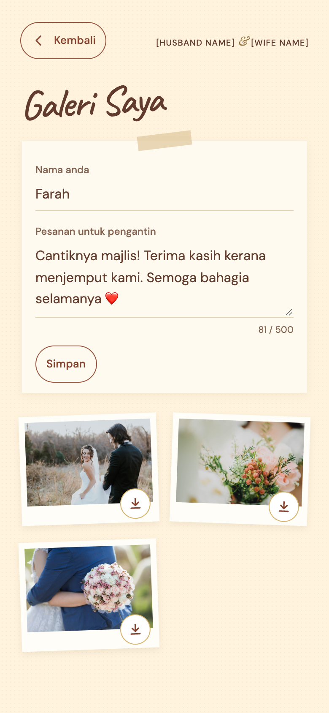
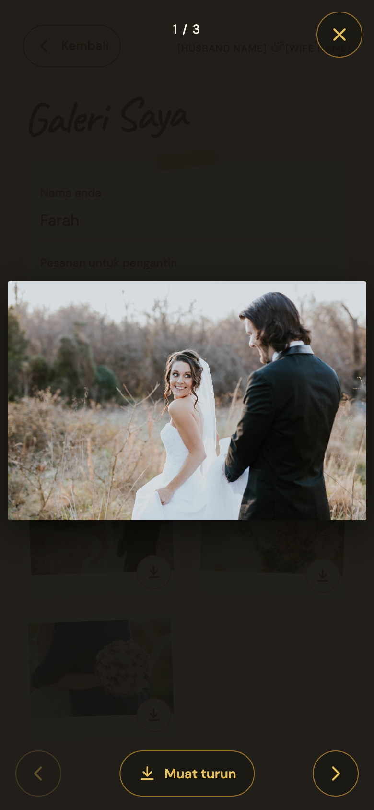
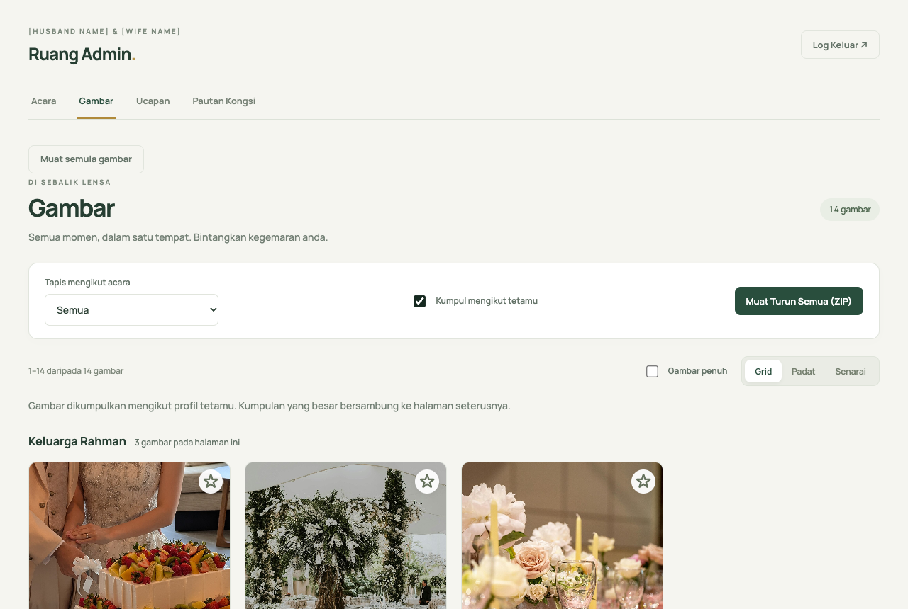
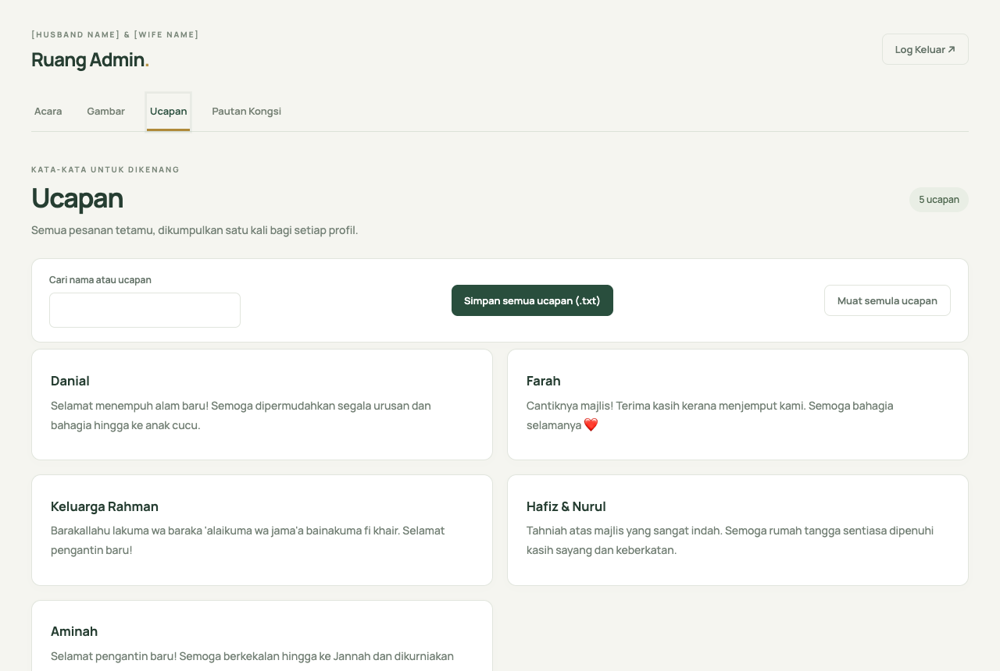

# Wedding Camera · Kamera Majlis

A photo-sharing web app for a Malay wedding. Guests scan a QR code, upload the
photos they took on their own phones, and the couple gets every photo, with the
untouched originals, in one private gallery. No app to install and no guest
accounts.

Built for and used by guests at a real wedding in 2026 (akad nikah and
reception), then reopened for a post-wedding upload week. The interface is in
Bahasa Melayu.

**Live demo:** https://wedding-camera-demo.pages.dev (sample photos, uploads
open; the admin side is shown in the screenshots below)

| Guest landing | Galeri Saya | Photo overlay |
|---|---|---|
|  |  |  |

| Admin gallery, grouped by guest | Guest wishes |
|---|---|
|  |  |

## What it does

**For guests**

- Pick photos from the phone's library, several at once. HEIC photos are
  converted in the browser on devices that cannot read them (Android, desktop
  Chrome), with a WebAssembly decoder that loads only when needed.
- Uploads survive bad venue Wi-Fi: a persistent queue in IndexedDB retries with
  backoff, resumes when the page is reopened, and shows an honest
  "N gambar dihantar ✓" count.
- Photos are resized to 4096 px for viewing. The untouched original is stored
  separately for the couple and never served to anyone else.
- "Galeri Saya" shows a guest only their own photos, with a full-screen viewer
  (swipe, pinch to zoom), save to phone, and a name and wish for the couple.
- Uploads open and close by themselves on each event's time window (akad,
  reception, a later upload week).
- Installable PWA; the app shell works offline.

**For the couple (password-protected admin)**

- Events and upload windows.
- Every photo in one gallery: filter by event, group by guest, star favourites,
  numbered pages that stay cached, three layouts, download all as a ZIP.
- All wishes in one place, searchable, exportable as a text file.
- A shareable read-only gallery link.
- An archive script that downloads every original (or the display copy where no
  original arrived) into folders per event and guest.

## How it is built

```
 guest's phone ──1. "may I upload?"──▶  Cloudflare Pages Functions ──▶ Supabase Postgres
      │         ◀──── presigned URL ───        (TypeScript API)          (photos, guests,
      │                                                                    events, RLS on)
      └──2. PUT the image directly ───────────▶ Cloudflare R2
                                                (display copies + private originals)
```

- **Frontend:** React 19, Vite, TypeScript, vite-plugin-pwa (Workbox).
- **API:** Cloudflare Pages Functions. Phones upload straight to R2 with
  short-lived presigned URLs, so image bytes never pass through the API.
- **Data:** Supabase Postgres with row-level security on every table; only the
  Functions (service role) talk to it.
- **Storage:** Cloudflare R2 for display copies and private originals.

Some details worth a look:

- **Offline-first uploads** (`src/lib/`): photos are processed and queued in
  IndexedDB before anything touches the network, so a closed tab or lost
  signal does not lose the photo; the queue carries on when the page reopens.
- **Private originals:** kept on the phone within a storage budget and uploaded
  only once the display copies are done, so they never slow the guest down.
- **Deploy safety:** every build gets a fresh asset hash, and a middleware guard
  turns an HTML fallback under `/assets/` into an uncacheable 404, added after a
  CDN cached an HTML page in place of a JavaScript bundle.
- **Abuse limits:** best-effort per-isolate rate limiting, a site-wide photo
  cap as a backstop, and input validation on every endpoint (`functions/_lib/`).
- **Tests:** 544 Vitest + Testing Library tests across the app and API, plus
  Playwright scripts in `scripts/` that check layouts at phone and desktop
  widths.

## Running it locally

```bash
npm install
npm test
npm run dev
```

`npm run dev` serves the frontend only. The API needs Cloudflare's local
runtime and seven secrets (listed in `wrangler.toml`) in a `.dev.vars` file:
a Supabase project with `supabase/migrations` applied, and an R2 bucket.

```bash
npm run build
npx wrangler pages dev dist
```

To use it for another wedding, the couple's names are in `src/config.ts` and the
link-preview card is in `index.html`.

## Licence

No licence is granted. This code is published so it can be read. All rights
reserved © 2026 tgraharms.

Photos in the screenshots and the demo are CC0 (public domain) images from
Wikimedia Commons.
